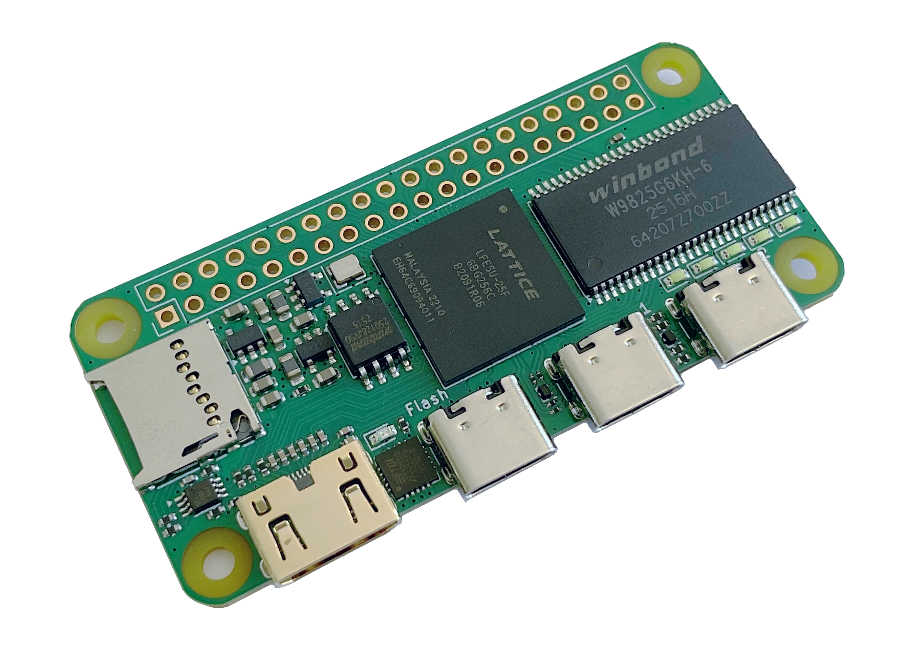
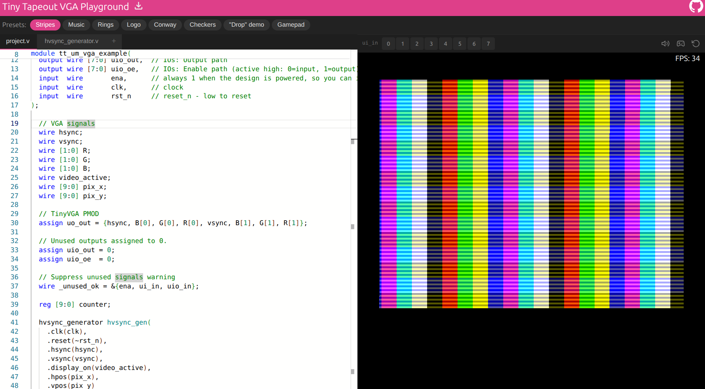
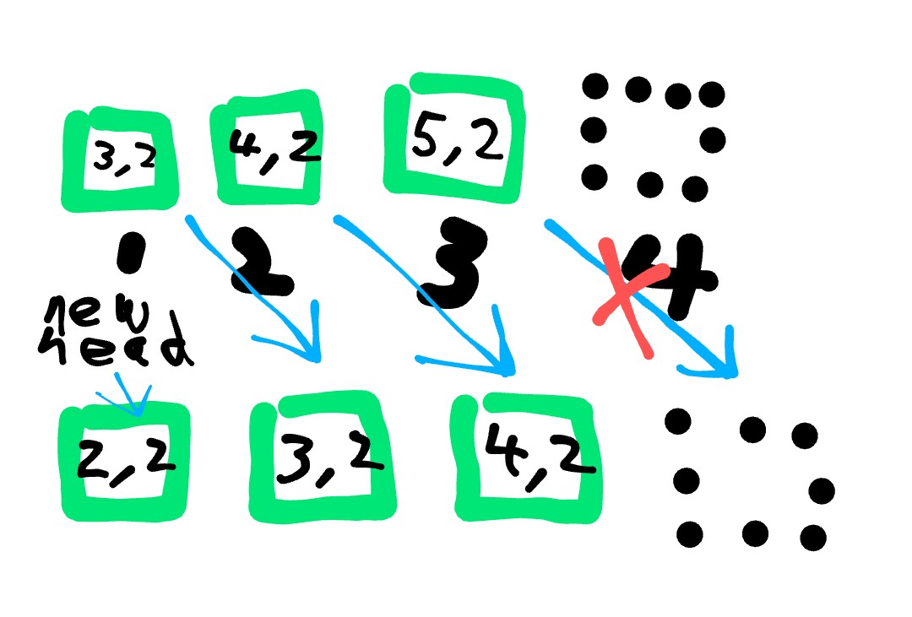

# hey! it's writeup time

this is the story of the pain i endured to make a project for hack club's [asic](https://asic.hackclub.com) ysws, strap in tight because it's about to get pretty writeuppy in here. 
written in lowercase except where i decide otherwise, because lowercase feels calmer.

## ok, so what even is a hack club asic ysws

[hack club](https://hackclub.com/) is this really awesome non-profit all about getting teens into coding and making projects. they do events called You Ship, We Ship(s) (YSWSs)
where the premise is that you 🫵 build _something_, normally related to the theme or topic of the ysws, and hack club will give you _something_ in return. 
it could be that you design a cookie cutter in 3d design software and receive your physical cookie cutter design and cookies ([bakebuild](https://bakebuild.hackclub.com)), or in this case
you build a project in verilog (keep reading and i'll explain what this is later), and hack club ships you an FPGA to test it on (pictured below), and once you've tested it, they'll fabricate your design, 
along with a bunch of other people's, onto a real manufactured ASIC chip!



you may notice it looks kind of familiar, that's because it is! it's designed to be the same size and shape as a raspberry pi zero, so it's compact and fits in where the pi zero does too.

## okkkkk, what's an fpga??

fpga stands for Field Programmable Gate Array, which means its got loads (1000s) of logic gates on it (like AND, NOT, OR, etc...) and you can decide how they are wired together. normally,
to do this yourself you'd need so many physical chips and run wires between them, so an FPGA means you can easily do so much more, and you can change the wiring instantly at your will.

real uses for this include digital audio mixers (like [the one my school has](https://www.allen-heath.com/hardware/qu/qu-5-qu-5d/)!) 
here's a [cool article](https://support.allen-heath.com/hc/en-gb/articles/37281423483665-XCVI-a-signal-processing-revolution-from-DSP-to-FPGA) about FPGAs in digital mixers. also aviation, space, and phone towers

---

## verilog

verilog is a Hardware Description Language (HDL). this means it's a special type of language where instead of telling a CPU what instructions to run,
you're describing a logical circuit which can then physically become a circuit of logic gates, either in an FPGA or fabricated as an ASIC chip.

just like how you don't have to program computers in assembly language, you also don't have to write verilog using just logic gates. verilog offers **procedures**, which
can express a circuit at a higher level. it all gets compiled down to logic gates at the end, but it's much easier to understand. they can either be

- constant logic gates (`always @(*)`) (this is known as combinational)
  
  or
  
- clocked (`always @(posedge clk)`) which means the circuit is only triggered at the rising edge of every clock cycle.

i started to learn verilog by using [the HDLBits problem set](https://hdlbits.01xz.net/wiki/Step_one)

by the time i got to [More Verilog Features/Reduction Operators](https://hdlbits.01xz.net/wiki/Reduction), i decided it was time to use my limited knowledge of the language in practice, and moved to [VGA playground](https://vga-playground.com/), which is a website where you can write verilog that makes a VGA output, and it gives you a visualisation of it.

## vga playground



at first, i was just messing around with the inputs, trying to figure out how it works and how it decides to draw what where. (sidenote: if you're making something in vga playground, please please make sure to frequently press the download button, because the site clears anything you've written any time the page reloads. i made this mistake numerous times, and while i guess it was a good learning opportunity to have to try and recall and redo what i had done previously, it was not fun)

the default demo project, stripes, has three main outputs you'll want to use, R, G, and B, which as you may have guessed, correspond to red green and blue. "but these aren't pixels, how do i output a picture??" you ask

that's done by timing when rgb are turned on or off to match where the "scan lines" currently are. this is done by comparing the values of pix_x and pix_y to where you want to draw, and setting the colours at the moment you want it to be drawn. say you wanted a red dot at (0, 0), you would check if pix_x == 0 and pix_y == 0, if true set R to 11 (the most red), G 00, B00, or otherwise set R 00, G 00, B 00. 

else branches are important in verilog, otherwise the value either won't change or could be undefined (x) which is bad and painful, i'll get on to this in more depth at a later point.

## snake

to actually make my game, i created a big array of registers that can store the different cells of the snake. this caused a problem though, because i had done it as `reg snake [127:0] [7:0]` which gave me an XML error in vga playground which wasn't helpful. turns out the right way is `reg [7:0] snake [127:0]`. vga playground isn't great at error handling and reporting, so i'd suggest trying to compile locally to get a helpful error description, or push to github and use the github actions logs.

---

here's the main logic that my snake runs on

every few clock cycles (determined with an always block clocked on the rising edge of 1 bit of the counter), the new head position is calculated by adding or subtracting from one of the x or y of the current head. it checks if the new head is equal to the current food position, and if it is, the length is increased by 1 and the food position is set to a random position, which may be a position on the snake body because I didn't feel like checking to make sure it's not. the way i generated a random number was just a pseudo random using random bits from the counter. it's a pretty decent pseudorandom because the counter is normally at a different point every time because it takes a different amount of time to travel and get between foods. the food position is `{counter[6], counter[1], counter[4], counter[3], counter[0], counter[5]}`

then, the snake body pieces are all moved along by 1, discarding the one at the end and setting the first place to the new head. below is a diagram! while this happens, it also checks if the new head is equal to the body piece it's currently moving which would mean the snake has hit itself, and if it is the game ends.



---

here's how it draws the snake

the x bits and y bits of the snake body pieces are compared every clock cycle with the 3 largest bits of pix_x and pix_y. If they are equal, green is drawn there (or grey if the snake has died), and if not, black is drawn. the same is done for the food except red is drawn. 

---

# suffering


hhhhhgg]]]]]]]]]]]]]]]]]]]]]]]]]]]]]]]]]]]]]]

yay! so i finished my project! it works and the snake is snakey!

loud incorrect buzzer

i then cloned [this template](https://github.com/TinyTapeout/ttgf-verilog-template) by pressing use this template, and put my verilog files in /src. it's useful to have this locally too.

i edited docs/info.md to describe my project

i then edited info.yaml, to set top_module to my module's name, source_files, title, author, description and pins. for VGA, that's

```yaml
  # Outputs
  uo[0]: "R1"
  uo[1]: "G1"
  uo[2]: "B1"
  uo[3]: "VSync"
  uo[4]: "R0"
  uo[5]: "G0"
  uo[6]: "B0"
  uo[7]: "HSync"
```

not too bad so far, but it wasn't obvious either, and definitely not the "Submitting is quite simple" that https://asic.hackclub.com/submission promised.

but wait there's more

oh no

## tests

i asked myself "what's the point in writing tests if i can see that it works??"

turns out, VGA playground is way too forgiving compared to a real chip, and you don't want to be forgiven because a bad chip won't forgive you. more on that later...

the repo comes with a handy folder called test. in this, is a test.py file which uses something called cocotb. don't ask me, i still don't know what it means, but what it does is it runs the logic of your design and lets you wait for logic events to happen, like counting how many clock cycles it takes for a signal to go high. it sounds rudimentary, but it's actually kind of useful. whilst it's hard to test exactly what your vga program is going to look like when it runs and how it's going to act, it's easy to check that the VGA timings are correct. 

here's the test code i wrote, with some extra comments for you

```py
    # check vga timings
    dut._log.info("Waiting hsync rise") # dut stands for device under test by the way, and it means the module that you're testing. cocotb can access internal wires and registers, but it's best practice to test the outputs only, because it doesn't matter what's going on inside the chip if what's coming out is wrong.
    await RisingEdge(dut.hsync) # waits for the hsync signal to rise and fall once, this means it won't get caught in the middle of a cycle and count the wrong number
    dut._log.info("Waiting hsync fall")
    await FallingEdge(dut.hsync)
    clock_count = 0
    while True:
        dut._log.info("Waiting clock rise")
        await RisingEdge(dut.clk) # wait for the clock to rise so it can then check if hsync is 1
        if dut.hsync.value == 1:
            dut._log.info("Breaking because hsync 1")
            break
        clock_count += 1
        dut._log.info(f"Clock count {clock_count}")

    assert clock_count == 96 # this means you're making the assertion that the clock count should be 96 (based on vga timings). if it's not, an error is raised.
    dut._log.info("Waiting vsync rise") # idk this bit's basically the same except vsync
    await RisingEdge(dut.vsync)  # vsync
    dut._log.info("Waiting vsync fall")
    await FallingEdge(dut.vsync)
    clock_count = 0
    while True:
        dut._log.info("Waiting hsync fall")
        await FallingEdge(dut.hsync)
        if dut.vsync.value == 1:
            dut._log.info("breaking because vsync is 1")
            break
        clock_count += 1
        dut._log.info(f"clock count {clock_count}")

    assert clock_count == 2
```

and it runs locally with `make` in /test yay, easy right?

wrong (again)

i then uploaded it. but gds failed. 

gds is the github action that generates the chip layout, you can think of it as compiling. it complained it the logs that the tile usage was at 377%. turns out, big arrays of registers and big for loops are big.

i started by reducing the length of the array, so there's a shorter maximum snake length, which helped, but i needed to reduce the grid size from 16x16 to a measly 8x8 to get enough improvement to matter. 

i now realise i could have just increased the number of tiles to use, but oh well. 

even though i got it to 92% at one point, it still failed with error "detailed placement failed". i think this is because yeah there's space for all the gates to exist, but not enough space to wire them up to each other.

yes, eventually i got it down to around 67% (six seven)

